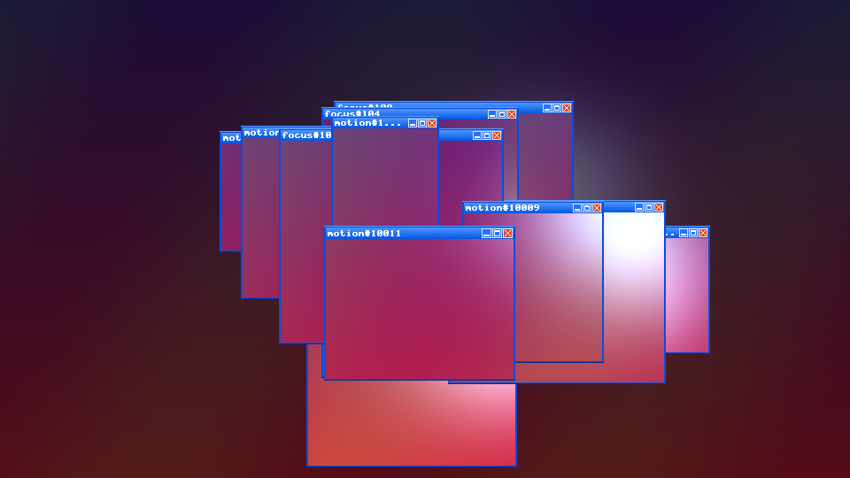
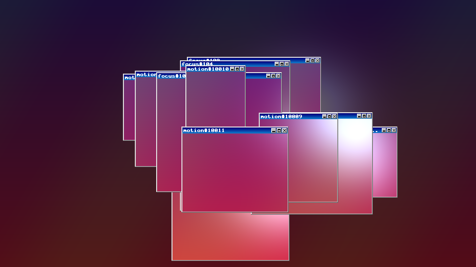
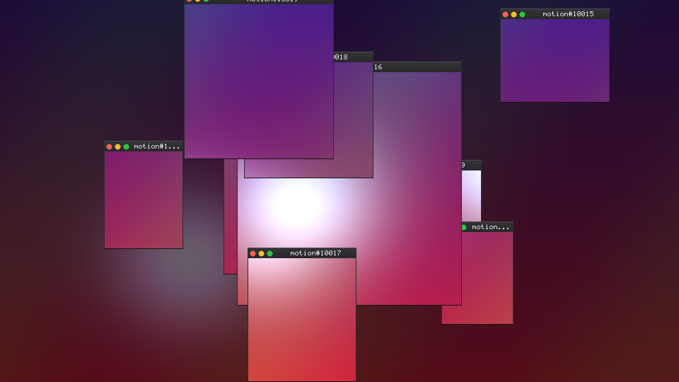
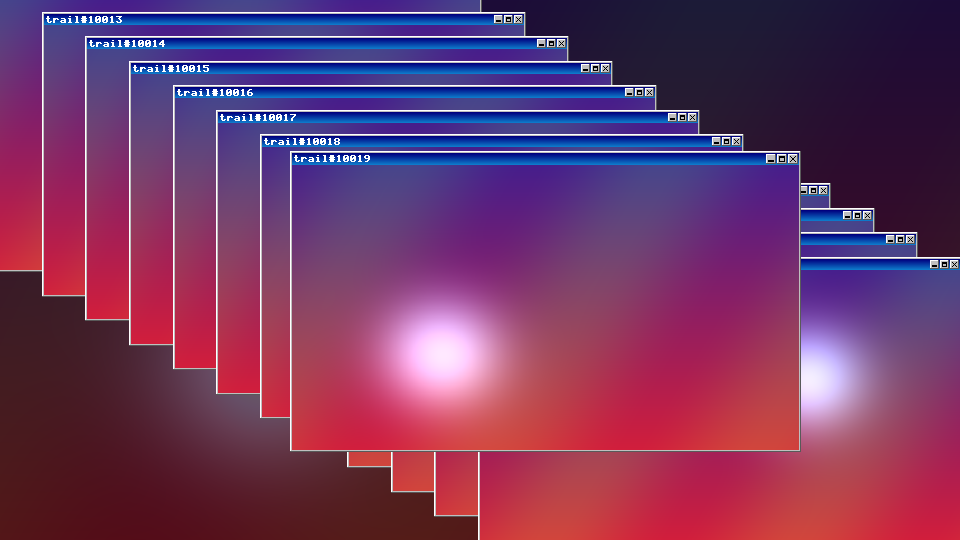

# WindowPop

An After Effects effect that pops retro desktop windows over your footage. Each window shows the part of the clip underneath it, frozen at the moment the window appeared, then disappears after a set time. It runs on macOS (Apple Silicon and Intel) and Windows.

| Glossy 2000s | Classic 90s |
|---|---|
|  |  |
| **Modern Dark (Mac)** | **Time Trail look** |
|  |  |

(These previews come from the standalone preview tool, rendered over synthetic test footage.)

## Why it's light

- **One effect on one layer.** No extra layers, precomps or masks.
- **Stateless.** The windows on screen at any time are calculated from the seed and the time alone, so it supports Multi-Frame Rendering, render farms and instant scrubbing.
- **The window frames are drawn in code**, with a tiny built-in pixel font. It doesn't need a text engine or image files, and looks the same on Mac and Windows.
- **Each frozen frame is fetched once** per render, however many windows share it.

## Controls (v0.1)

| Control | What it does |
|---|---|
| Look | Motion Windows (scattered windows cropping the footage beneath) or Time Trail (full-frame windows cascading diagonally) |
| Amount | Windows spawned per second |
| Trail Length | How long each window stays up, in seconds |
| Window Size | Base window height as a percentage of the frame |
| Random Seed | Different but repeatable layouts |
| Focus / Focus Point | Every fourth window is a larger "focus" window around this point. Link it to a track point with an expression |
| Window Style | Glossy 2000s, Classic 90s, Modern Dark (Mac), Modern Light (Mac) |
| Interface Scale | Size of the title bars and borders (100% is sized for 1080p) |
| Entrance | Pop In, Fade In, None |
| Background | Original, Dimmed, Solid Color, Transparent |

## Layout

```
src/core/      host-independent C++17: window simulation + renderer (8/16/32-bit)
src/ae/        After Effects wrapper (WindowPopAE.cpp) and PiPL resource
tools/         preview.cpp renders test frames without After Effects
docs/previews/ sample output
```

## Try the core without After Effects

```
cmake -S . -B build && cmake --build build
./build/preview /tmp 0 0     # style 0-3, look 0-1; writes frame_*.ppm
```

## Build the After Effects plugin

### macOS (one script)

```
xcode-select --install                                   # once: Apple's command line tools
./scripts/build_mac.sh ~/Downloads/<unzipped-AE-SDK-folder> --install
```

This builds `build/mac/WindowPop.plugin` (Apple Silicon and Intel) and copies it to `/Library/Application Support/Adobe/Common/Plug-ins/7.0/MediaCore/`. Restart After Effects and find it under **Effect > Stylize > WindowPop**.

### Windows

1. Copy the SDK's `Examples/Template/Skeleton` to `Examples/Effect/WindowPop`.
2. Replace the Skeleton sources with `src/ae/WindowPopAE.cpp`, `src/ae/WindowPopPiPL.r`, `src/core/WindowPop.cpp` and `src/core/WindowPop.h` (fix the core include path).
3. Open the Visual Studio solution, rename the project, point the PiPL custom build step at `WindowPopPiPL.r`, and build x64 Release.
4. Copy `WindowPop.aex` to `C:\Program Files\Adobe\Common\Plug-ins\7.0\MediaCore\`.

If AE reports an out-flags mismatch when the plugin loads, it shows the expected value. Copy that value into `AE_Effect_Global_OutFlags` in the PiPL.

## Status and roadmap

- [x] v0.1: core simulation and renderer, four styles, two looks, AE wrapper (8/16 bpc, MFR)
- [ ] Verify the build on macOS and Windows with the AE SDK (not compiled against the SDK yet)
- [ ] Motion-driven spawning: tiny downscaled frame differences, cached per frame (the core already accepts a `MotionPicker`)
- [ ] SmartFX render path, for 32 bpc and to fetch only the cropped regions of earlier frames (less memory at 4K)
- [ ] More styles, exit animation, drop shadows, custom title text
- [ ] Optional GPU path (Metal / CUDA)
